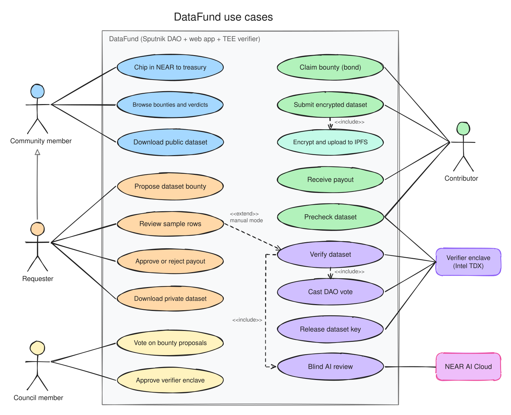
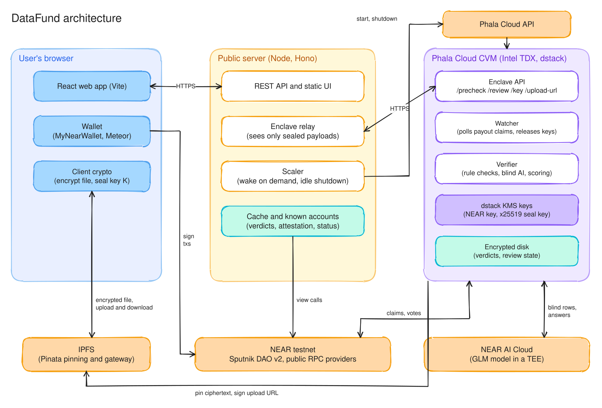
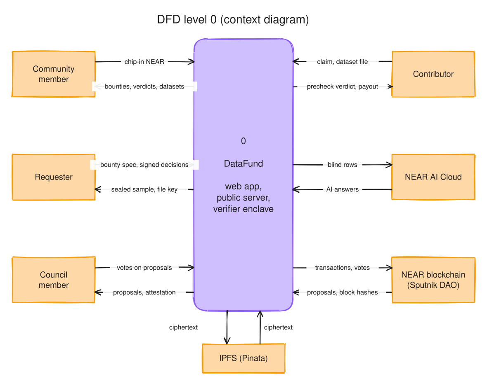
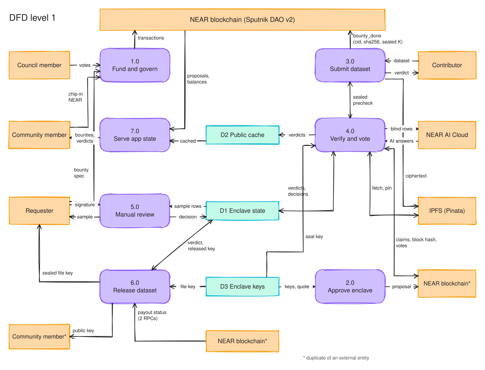
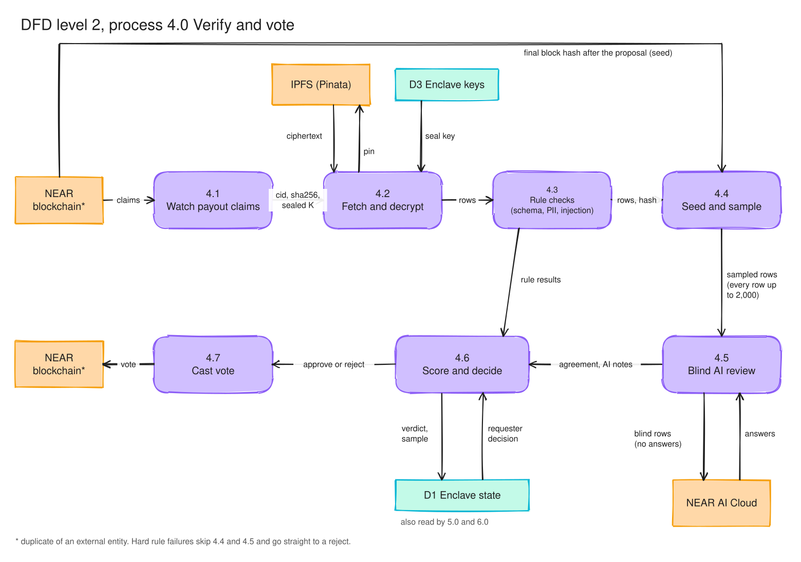

# DataFund, community-funded datasets on NEAR

**Track** Social Money (shared budgets and community rewards with Sputnik DAO)

DataFund lets a community pool NEAR in a Sputnik DAO treasury, vote on which datasets to fund, and pay
contributors once their data passes review. Datasets are encrypted in the contributor's browser and only a verifier
running in a TEE (Intel TDX on Phala Cloud) can read them. The DAO approves that enclave by vote, the enclave
checks every row with blind AI review, and the dataset key is released only after the contributor is paid.

## How it works

```
Requester ──AddBounty (task type, review mode)──▶ council votes ──▶ bounty is open
Contributor ──bounty_claim (bond)
Contributor browser
  encrypt file with a random key K ──▶ ciphertext to IPFS (or any https host)
  seal K to the enclave's key      ──▶ bounty_done({cid, sha256, sealed K})
Enclave (Phala dstack CVM, Intel TDX)
  unseal K, decrypt, check sha256
  seed = sha256(file hash + hash of the first final block after the proposal)
  auto    ──▶ checks and blind AI on every row ──▶ VoteApprove / VoteReject
  manual  ──▶ AI pre-screens every row ──▶ requester reviews a sample (signed with their wallet) ──▶ vote
  payout Approved (confirmed by two RPC providers) ──▶ publish K, the dataset becomes public
DAO ──payout on approval──▶ Contributor
```

- **Treasury and governance.** A Sputnik DAO v2 created from the public factory `sputnik-v2.testnet` (no custom
  contract). The enclave is the only member of a `verifier` role whose permissions are just
  `bounty_done:VoteApprove` and `bounty_done:VoteReject`. The council can still vote on any proposal.
- **The DAO approves the enclave.** `npm run enclave:approve` files an `AddMemberToRole` proposal whose description
  carries the enclave's attestation (seal key, NEAR key, compose hash, app id and a hash of the TDX quote). The
  quote binds both keys (report data is the NEAR key followed by the seal key). Council members check it and vote.
  The web app reads the seal key from that approved proposal and warns if the enclave in front of it doesn't match.
- **Keys never leave the enclave.** Its NEAR key (an implicit account) and its x25519 seal key are derived by the
  dstack KMS from the app identity. They never touch disk, and a restarted or moved CVM gets the same keys back.
- **Task types.** Each one says what the AI redoes blind.

  | Task | Row | AI does blind | Agreement | Default bar |
  |---|---|---|---|---|
  | Classification | `text`, `label` (closed set) | Picks a label | Exact match | 80% |
  | Question and answer | `question`, `answer` (short) | Answers the question | Normalized match, then an equivalence check that doesn't say which answer was submitted | 60% |
  | Preference pairs | `prompt`, `response_a`, `response_b`, `preferred` | Picks the better response | Exact match, with A and B swapped on a seeded half of the rows to cancel position bias | 70% |

- **Review modes.** The requester picks one per bounty.
  - **Automatic.** The enclave decides. Score = 30% structural + 40% agreement + 30% AI quality. It approves at 70
    or more when no hard check failed. Agreement under the bar is a hard failure.
  - **Manual.** The requester sees at least 100 random rows plus rows the AI disagreed with, never more than 20% of
    the file (manual bounties need 500+ rows). They approve or reject with a free NEP-413 wallet signature, and the
    enclave casts the vote. If they don't decide within the review window (default 48 h), auto review decides.
    Hard rule failures (bad hash, personal data, prompt injection, wrong schema) are rejected at once in both modes.
- **Access after payout.** The requester picks one per bounty.
  - **Public** (default). The enclave publishes the file key and anyone can download and decrypt the dataset.
    This fits bounties paid from the community treasury.
  - **Requester only.** The key stays in the enclave. The verified requester signs a free wallet message and the
    enclave returns the key sealed to that page. Nobody else can decrypt the file on IPFS. This controls who gets
    the data from the enclave, not what they do with it afterwards, and the contributor still has their own copy.
    The council should expect the requester to fund such a bounty, since treasury money would otherwise buy
    private data.
- **Why junk can't hide.** Files up to 2,000 rows have every row redone by the AI, not a sample. Bigger files get
  500 random rows. The sample is seeded by a block hash that didn't exist when the file was committed, and anyone
  can rerun the sampler with the block height in the verdict. A contributor can't place good rows where checks will
  land.

  | Junk share | 100 random rows miss it | 500 random rows miss it | Full scan |
  |---|---|---|---|
  | 1% | 37% | 0.7% | 0% sampling risk |
  | 2% | 13% | 0.004% | 0% |
  | 5% | 0.6% | ~0% | 0% |

- **Nobody can take the data without paying.** The requester only ever sees the sample. Private answers from the
  enclave (precheck results, review samples, AI notes) are sealed to a one-time key held by the page that asked, so
  the public server relaying them sees only ciphertext. The key is published only after two RPC providers confirm
  the payout was approved, and only the requester gets it on requester-only bounties. Rejected files stay encrypted.
- **No file hosting.** Contributors upload the encrypted file straight to IPFS with a short-lived Pinata URL signed
  by the enclave, or host it anywhere themselves. The enclave pins each submission to the DAO's Pinata account so it
  stays available after payout.
- **AI.** NEAR AI Cloud (`z-ai/glm-5.3-flash`, a TEE-verifiable model), in batches of 25 rows. Rows are always sent
  without the submitted answers, and replies missing most answers are retried rather than counted as disagreement.

## Diagrams

Each diagram has an SVG for reading and an `.excalidraw` source next to it in `docs/diagrams`. Open the source at
[excalidraw.com](https://excalidraw.com) to edit it.

### Use cases

Who does what. The requester is a community member who also proposes bounties. The verifier enclave and NEAR AI
Cloud are system actors.



### Architecture

The browser encrypts files and signs transactions. The public server relays sealed payloads and wakes or sleeps the
enclave. The enclave runs in a Phala Cloud CVM and holds every key.



### Data flow, level 0

DataFund as one process, with the people and services it exchanges data with.



### Data flow, level 1

The seven main processes and the three data stores. An entity marked with an asterisk is drawn twice to keep lines
short.



### Data flow, level 2

Process 4.0 Verify and vote in detail, from a payout claim on chain to the enclave's vote.



## Run it

You need Node 20+ (tested on Node 24). Rust is not needed.

```bash
npm install
cp .env.example .env          # add NEAR_AI_API_KEY and, for IPFS upload, PINATA_JWT
npm run build                 # build the web UI
npm run dev                   # enclave (dev keys), public server and UI with hot reload
```

`npm run dev` starts the enclave with `ENCLAVE_DEV=true`. Without a TEE it keeps its keys in a local file and has no
attestation. The app shows it as Dev mode. For a production-like run, start the two services separately.

```bash
ENCLAVE_DEV=true npm run start:enclave   # or inside a dstack CVM, without ENCLAVE_DEV
npm run start:server                     # API, relay and UI on http://localhost:8787
```

`npm run selftest` runs the enclave verifier in-process against every example file (encryption round trips,
sampling, all three task types, the facade file and manual sampling limits).

### Deploy the enclave to Phala Cloud

1. Build and push `deploy/Dockerfile.enclave`, then pin the image by digest.
2. Create a CVM from `deploy/docker-compose.phala.yml` with `ENCLAVE_IMAGE`, `DAO_ID` and the encrypted secrets
   `NEAR_AI_API_KEY`, `PINATA_JWT` and `PINATA_GATEWAY`.
3. Point the public server at it with `ENCLAVE_URL`.
4. File the approval with `ENCLAVE_URL=... PROPOSER=you.testnet OLD_VERIFIER=<previous verifier> npm run enclave:approve`.
   This funds the enclave's implicit account for gas and files the role proposals. Then the council votes.
   Removing the old verifier matters, since with two members in the role a single verifier vote is no longer enough.

### Scale to zero

Set `PHALA_CLOUD_API_KEY` and `PHALA_CVM_ID` for the public server and it runs the enclave only when needed.
- It wakes the CVM (Phala API `start`) for a payout claim without a vote, a manual review that was decided or ran
  out of time, a payout whose key isn't released yet, or any browser request to the enclave. Opening the submit
  form wakes it ahead of time.
- It shuts the CVM down gracefully (`shutdown`) after `IDLE_MINUTES` (default 10) with no work, no requests and no
  running jobs in the enclave.
- Verdicts, the attestation and the enclave status are cached on the public server. The app keeps showing them
  while the enclave sleeps.
- Keys survive this, since they come from the app id. **Never delete the CVM to save money.** A new CVM has new
  keys. Files sealed to the old key can no longer be decrypted, and the DAO has to approve the new enclave.
- Waking takes about a minute. Proposals stay open for 72 h, so nothing is missed while it sleeps.

### Your own DAO

`.env.example` points at the live demo DAO `datafund-41bbcc.sputnik-v2.testnet`. To run your own, do this.

```bash
npx near account create-account sponsor-by-faucet-service <owner>.testnet autogenerate-new-keypair save-to-legacy-keychain network-config testnet create
OWNER=<owner>.testnet VERIFIER=<owner>.testnet DAO_NAME=<name> npm run setup:dao
```

Then set `DAO_ID=<name>.sputnik-v2.testnet` in `.env`, start the enclave and approve it as above.

Chain reads and enclave votes rotate round-robin across the public keyless RPC providers from
[docs.near.org](https://docs.near.org/api/rpc/providers) (`shared/rpc.ts`). A rate-limited or unreachable node is
skipped for 30 seconds. Set `NEAR_RPC_URLS` (comma-separated) to use your own list.

## Try it

1. Open http://localhost:8787. The page shows the treasury, open bounties, the activity feed and the verifier
   enclave panel (TEE or Dev mode, and whether the DAO approved it).
2. Click **Connect wallet** and sign in with a testnet account (MyNearWallet or Meteor). Then **Chip in** 1 NEAR.
3. Open **Propose a dataset bounty**. Pick a task type (classification, question and answer, preference pairs) and a
   review mode. Once a council member clicks **Approve**, it moves to Open bounties.
4. On a bounty, click **Claim**, then **Submit dataset**. Load a sample and click **Precheck**. The file is encrypted
   in the page, checked in the enclave and the verdict comes back sealed to the page. Good samples pass. The bad
   SMS sample fails on rules, and the mislabeled, wrong-answer and flipped samples fail on AI agreement.
5. Click **Submit on-chain**. The encrypted file goes to IPFS and a "Payout claim" shows up in Activity.
   - **Automatic bounty.** The enclave votes within about 10 seconds.
   - **Manual bounty.** The requester opens the claim, clicks **Review sample rows**, signs a free message and sees
     the sample (rows the AI flagged are marked). **Approve payout** or **Reject** is another signature, and the
     enclave votes. Try the **facade** sample. Its first 420 rows are honest and the last 180 have flipped labels.
6. Once the payout is approved, the claim shows **Download dataset**. The page fetches the encrypted file from IPFS,
   decrypts it with the released key and checks its hash. On a requester-only bounty only the requester sees the
   button, and it asks for one wallet signature first.
7. Click a bounty's cover or **Bounty dashboard** to see its reward, slots, participants and every verdict.

### From the terminal (no browser wallet needed)

`scripts/demo.sh` signs each step with keys in `~/.near-credentials`, and the UI updates live.

```bash
scripts/demo.sh chip-in  you.testnet 2
scripts/demo.sh propose  you.testnet "Scam vs legit SMS" "scam|legit" 1    # prints proposal id
TASK=qa REVIEW=manual scripts/demo.sh propose you.testnet "Arithmetic QA" - 1 3 500
ACCESS=requester scripts/demo.sh propose you.testnet "Private SMS set" "scam|legit" 1
scripts/demo.sh approve  you.testnet <proposal-id>                           # each council member votes
scripts/demo.sh claim    you.testnet <bounty-id>
scripts/demo.sh submit   you.testnet <bounty-id> web/public/examples/sms-scam-good.jsonl
scripts/demo.sh status   you.testnet
```

`npx tsx scripts/precheck.ts <bounty-id> <file>` encrypts a file and prechecks it against the enclave directly.

These runs were verified on testnet with the earlier single-server verifier.
- **Proposal #6.** A bounty that needed both council votes. It stayed `InProgress` after one vote and became
  `Approved` after the second.
- **Proposal #7.** A good dataset. The verifier scored it 96 and approved, and 1 NEAR was paid out.
- **Proposal #8.** A mislabeled dataset. Every rule check passed, but AI label agreement was 46%. The verifier
  rejected it and no payout was made.

## Notes and known limits

- **Sputnik v2 quirks on testnet.** The factory deploys an older contract version. `bounty_done` rejects attached
  deposits but checks `deposit == proposal_bond`. `proposal_bond` must be 0 for payouts to work. Also, a
  completed claim stays on record. Each account can complete a given bounty once. That works as a
  "one submission per contributor" rule.
- **Claim bond.** In this contract version the 0.1 NEAR claim bond is refunded only through `bounty_giveup`
  within the forgiveness period. Once work is submitted, the bond stays in the treasury as an anti-spam stake.
- **Trust in the page.** The web page is still served by the operator. A tampered page could seal a file to the
  wrong key. The app checks the seal key against the DAO-approved proposal, which narrows this but doesn't remove
  it. The terminal scripts don't depend on the page.
- **Model calls leave our enclave for NEAR AI's.** Both run in TEEs. Checking NEAR AI's attestation from inside the
  enclave before sending rows is not done yet.
- **Release is final.** Once a public key is published, or a requester downloads a private dataset, it can't be
  taken back.
- **Manual review needs the requester to have proposed the bounty.** The enclave only accepts a reviewer named in
  the spec who also proposed the approved `AddBounty`. Otherwise auto review decides.
- **Scale to zero is unverified on billing.** Phala's API docs don't say whether a stopped CVM still costs
  anything (disk, reserved node). Check your Phala billing after a day of sleep.
- **Proposal period.** This DAO's proposals expire after 72 h. The review window is capped at 60 h to stay inside that.
- Testnet only. No real funds.

## Built with

- [Sputnik DAO v2](https://github.com/near-daos/sputnik-dao-contract) for treasury, bounties, proposals and voting
- [NEAR AI Cloud](https://docs.near.ai/) for OpenAI-compatible inference on TEE-verifiable models
- [Phala Cloud dstack](https://github.com/Dstack-TEE/dstack) for the Intel TDX enclave, key derivation and attestation
- [Pinata](https://pinata.cloud) for IPFS uploads and pinning
- near-api-js, NEAR Wallet Selector (MyNearWallet, Meteor), near-cli-rs
- Hono, React, Vite, TypeScript

## AI disclosure

Most of this code was written with Claude Code (Anthropic) under the author's direction. The author chose the
design, ran the testnet tests and reviewed the result.

## License

MIT. See [LICENSE](LICENSE).
